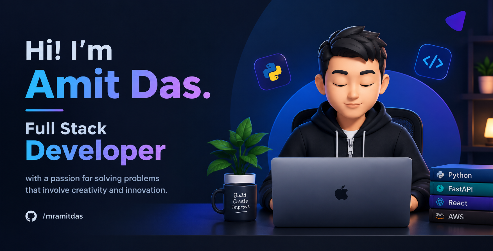

<a href="https://github.com/mramitdas">
 
</a>
<p align="center">

<!--Header-->

<br/>
<a href="https://github.com/mramitdas">
 
</a>
<a href="https://github.com/mramitdas">
 
</a>
<a href="https://github.com/mramitdas">
 
</a>
<p align="center">

> [!CAUTION]
> - 🔖 You found me — **Amit Das**, SDE III · 7+ years turning fuzzy ideas into services, schemas, and UIs you can run at 2 a.m. without fear.

> [!NOTE]
> - 🚙 I build multi-tenant systems that don't flinch — Python underneath, React on top, Postgres RLS as the boundary that holds.

> [!IMPORTANT]
> - 🧑‍💻 whoami:
>
> ```python
> #!/usr/bin/env python3
> """whoami — but type-safe."""
>
>
> class SoftwareEngineer:
>     name: str = "Amit Das"
>     role: str = "SDE III"
>     building: str = "Forge · multi-tenant gym ERP"
>     core: str = "Python → FastAPI → Postgres RLS → Next.js"
>     edge: str = "Redis · Docker · AWS · TypeScript"
>     ask: str = "system design · schemas · DX · sharp UI"
>
>     def __str__(self) -> str:
>         rows = (
>             ("who", self.name),
>             ("role", self.role),
>             ("now", self.building),
>             ("core", self.core),
>             ("edge", self.edge),
>         )
>         w = max(len(k) for k, _ in rows)
>         rule = "─" * 42
>         body = "\n".join(f"  {k:<{w}}  {v}" for k, v in rows)
>         return f"╭{rule}╮\n{body}\n╰{rule}╯"
>
>
> print(SoftwareEngineer())
> ```

> [!TIP]
> - 📗 The stack I reach for daily — hover any icon for the name, click for docs.

| | Stack |
|---|---|
| **Languages** | <a href="https://www.python.org" title="Python"></a> <a href="https://www.typescriptlang.org" title="TypeScript"></a> <a href="https://developer.mozilla.org/en-US/docs/Web/JavaScript" title="JavaScript"></a> <a href="https://en.wikipedia.org/wiki/C_(programming_language)" title="C"></a> <a href="https://isocpp.org" title="C++"></a> <a href="https://dotnet.microsoft.com/languages/csharp" title="C#"></a> <a href="https://developer.mozilla.org/en-US/docs/Web/HTML" title="HTML"></a> <a href="https://commonmark.org" title="Markdown"></a> <a href="https://www.latex-project.org" title="LaTeX"></a> <a href="https://www.w3.org/Graphics/SVG" title="SVG"></a> <a href="https://www.gnu.org/software/bash/" title="Bash"></a> <a href="https://learn.microsoft.com/en-us/powershell/" title="PowerShell"></a> <a href="https://nodejs.org" title="Node.js"></a> |
| **Markup & Scripting** | <a href="https://commonmark.org" title="Markdown"></a> <a href="https://www.latex-project.org" title="LaTeX"></a> <a href="https://www.w3.org/Graphics/SVG" title="SVG"></a> <a href="https://www.gnu.org/software/bash/" title="Bash"></a> <a href="https://learn.microsoft.com/en-us/powershell/" title="PowerShell"></a> |
| **Frontend** | <a href="https://react.dev" title="React"></a> <a href="https://vuejs.org" title="Vue.js"></a> <a href="https://nextjs.org" title="Next.js"></a> <a href="https://tailwindcss.com" title="Tailwind CSS"></a> <a href="https://getbootstrap.com" title="Bootstrap"></a> <a href="https://jquery.com" title="jQuery"></a> <a href="https://sass-lang.com" title="Sass"></a> <a href="https://webpack.js.org" title="webpack"></a> <a href="https://mui.com" title="Material UI"></a> |
| **Backend** | <a href="https://www.djangoproject.com" title="Django"></a> <a href="https://fastapi.tiangolo.com" title="FastAPI"></a> <a href="https://flask.palletsprojects.com" title="Flask"></a> <a href="https://nodejs.org" title="Node.js"></a> <a href="https://developer.android.com/studio" title="Android Studio"></a> |
| **Databases & Messaging** | <a href="https://www.postgresql.org" title="PostgreSQL"></a> <a href="https://www.mongodb.com" title="MongoDB"></a> <a href="https://www.mysql.com" title="MySQL"></a> <a href="https://www.sqlite.org" title="SQLite"></a> <a href="https://redis.io" title="Redis"></a> <a href="https://cassandra.apache.org" title="Cassandra"></a> <a href="https://aws.amazon.com/dynamodb/" title="DynamoDB"></a> <a href="https://supabase.com" title="Supabase"></a> <a href="https://kafka.apache.org" title="Kafka"></a> <a href="https://www.rabbitmq.com" title="RabbitMQ"></a> |
| **Cloud & DevOps** | <a href="https://aws.amazon.com" title="AWS"></a> <a href="https://cloud.google.com" title="Google Cloud"></a> <a href="https://azure.microsoft.com" title="Azure"></a> <a href="https://firebase.google.com" title="Firebase"></a> <a href="https://www.heroku.com" title="Heroku"></a> <a href="https://vercel.com" title="Vercel"></a> <a href="https://replit.com" title="Replit"></a> <a href="https://www.netlify.com" title="Netlify"></a> <a href="https://www.docker.com" title="Docker"></a> <a href="https://nginx.org" title="Nginx"></a> <a href="https://www.notion.so" title="Notion"></a> |
| **Tooling & VCS** | <a href="https://www.npmjs.com" title="npm"></a> <a href="https://yarnpkg.com" title="Yarn"></a> <a href="https://github.com/features/actions" title="GitHub Actions"></a> <a href="https://www.vim.org" title="Vim"></a> <a href="https://www.postman.com" title="Postman"></a> <a href="https://www.selenium.dev" title="Selenium"></a> <a href="https://regex101.com" title="Regex"></a> <a href="https://git-scm.com" title="Git"></a> <a href="https://github.com" title="GitHub"></a> <a href="https://gitlab.com" title="GitLab"></a> <a href="https://bitbucket.org" title="Bitbucket"></a> |
| **Design & Misc** | <a href="https://www.figma.com" title="Figma"></a> <a href="https://www.adobe.com/products/photoshop.html" title="Photoshop"></a> <a href="https://www.adobe.com/products/illustrator.html" title="Illustrator"></a> <a href="https://www.adobe.com/products/aftereffects.html" title="After Effects"></a> <a href="https://www.adobe.com/products/xd.html" title="Adobe XD"></a> <a href="https://www.arduino.cc" title="Arduino"></a> <a href="https://wordpress.org" title="WordPress"></a> <a href="https://codepen.io" title="CodePen"></a> <a href="https://obsidian.md" title="Obsidian"></a> <a href="https://stackoverflow.com" title="Stack Overflow"></a> |

<!-- ## My Engineering Philosophy

> [!NOTE]
> - 🧱 **Build systems, not scripts** — every solution should compose, scale, and survive handoff to future-you.

> [!TIP]
> - 🔍 **Debug root cause, not symptoms** — a stack trace is a clue, not an answer.

> [!IMPORTANT]
> - 📐 **Schemas are contracts** — design the data model first; the API follows.

> [!WARNING]
> - 🚀 **Ship small, ship often** — big-bang releases are how outages get born. -->

## GitHub Dashboard

<!-- Stats + top languages + streak -->

<details>
<summary>More</summary>

<!-- Contribution snake -->
<!-- Recent activity feed -->

</details>

## Let's Connect

<!-- GitHub, LinkedIn -->

<details>
<summary>Holopin</summary>

<!-- Holopin board -->

</details>

<p align="center">
  <b>Build thoughtfully. Automate intelligently. Ship reliably.</b>
</p>
